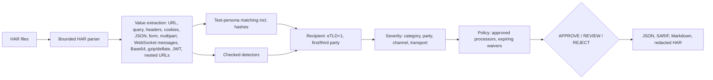

# Privacy Flow Inspector

[](https://github.com/Sushant-Nemade/privacy-flow-inspector/actions/workflows/ci.yml)
[](https://github.com/marketplace/actions/privacy-flow-inspector)
[](https://pypi.org/project/privacy-flow-inspector/)
[](https://github.com/Sushant-Nemade/privacy-flow-inspector/blob/main/LICENSE)

**Which personal data leaves the browser, who receives it, and how?**

Privacy Flow Inspector reads recorded web traffic (HAR files from Chrome, Firefox or Playwright)
and reports every place where personal data is sent: in URLs, headers, cookies, JSON, forms,
Base64 blobs or login tokens, including **hashed** forms that ad pixels use. It groups recipients
into first and third parties, applies your policy and gives an **APPROVE / REVIEW / REJECT** decision
for CI. It works offline. Reports contain **no raw personal data**, and it can export a redacted HAR
that is safe to attach to a ticket.

> Status: [v0.3.0](https://github.com/Sushant-Nemade/privacy-flow-inspector/releases/tag/v0.3.0), an alpha
> release on [PyPI](https://pypi.org/project/privacy-flow-inspector/) and the
> [GitHub Marketplace](https://github.com/marketplace/actions/privacy-flow-inspector).
> Tested on Windows, Linux and macOS. CI re-records a demo with real Chromium from both Python and a
> Node.js Playwright Test suite on every run and requires identical findings. Findings are technical
> evidence for a privacy review, not legal advice or a GDPR compliance verdict.

Part of a small **software trust toolkit** with
[Software Intake Gatekeeper](https://github.com/Sushant-Nemade/software-intake-gatekeeper): the
Gatekeeper checks what is **inside** an app; this tool checks what the app **sends out**. Both use the
same decision model, policy style and report formats.


## Where it helps

| Who | Situation | What they get |
|---|---|---|
| QA and end-to-end tests | The Playwright suite runs on every pull request | The build fails if the test user's email reaches an analytics domain |
| Data protection officer | Before a release, a DPIA or a records-of-processing update | A data-flow map of which data categories go to which recipients |
| Healthcare and patient portals | Checking for health-data leaks | Alerts when diagnosis fields or German health-insurance numbers reach third parties |
| Marketing / tag-manager changes | A new pixel or session-replay script is added | Detection of hashed emails and Base64-wrapped or gzip-compressed form snapshots |
| Support chat and real-time widgets | A chat or collaboration widget is embedded | Personal data in WebSocket messages, including Socket.IO and SignalR framing |

## Quick start

Install from [PyPI](https://pypi.org/project/privacy-flow-inspector/) (Python 3.11+) and scan a HAR file:

```powershell
python -m pip install privacy-flow-inspector

privacy-flow-inspector scan session.har --config pfi.toml `
  --json reports/report.json --sarif reports/report.sarif --markdown reports/summary.md `
  --redact-dir reports/redacted
```

Exit status: `0` the decision passed `--fail-on` (default `reject`), `1` the gate failed, `2` usage or
input error. `privacy-flow-inspector rules` lists the detectors.

### Recording a HAR

| Tool | How |
|---|---|
| Chrome / Edge DevTools | Network panel, then **Export HAR**. Includes WebSocket messages. The sanitized export leaves out cookies and `Authorization`; those then cannot be checked. |
| Firefox DevTools | Network panel, then **Save All As HAR**. |
| Playwright Test (Node) | Use the [privacy fixture](https://github.com/Sushant-Nemade/privacy-flow-inspector/tree/main/examples/playwright-node): one HAR per test, with request bodies and WebSocket messages |
| Playwright (Python) | `browser.new_context(record_har_path="session.har", record_har_content="embed")` |
| Playwright (Node, plain) | `browser.newContext({ recordHar: { path: "session.har", content: "embed" } })` |

Use `content="embed"`: with `omit` or `attach`, Playwright leaves **request bodies** out of the HAR.
The inspector detects this and reports a blocking `body-not-recorded` gap instead of approving.
Playwright also never writes **WebSocket messages** into HAR files; the inspector reports a
`websocket-not-recorded` gap for such sockets (blocking for third parties), and the Node fixture
above records them.

### Playwright Test (Node) in CI

[examples/playwright-node](https://github.com/Sushant-Nemade/privacy-flow-inspector/tree/main/examples/playwright-node)
is a ready-to-copy setup. Import `test` from `privacy-fixture.ts` instead of `@playwright/test`;
every test then leaves `test-results/<test>/network.har`, which the action scans:

```ts
import { test, expect } from "./privacy-fixture";

test("signup", async ({ page }) => {
  await page.goto("https://staging.example.com/signup");
  // ... fill the form with your test persona ...
});
```

CI runs this example on every push and requires the same findings as the Python recording.

### Try the fictional demo

[examples/demo-shop](https://github.com/Sushant-Nemade/privacy-flow-inspector/tree/main/examples/demo-shop) is a deliberately leaky, fictional health shop.
[scripts/record_demo.py](https://github.com/Sushant-Nemade/privacy-flow-inspector/blob/main/scripts/record_demo.py) drives it with real Chromium and answers every
request locally, so nothing leaves the machine. The recorded capture is committed as
[examples/recorded/demo-shop.har](https://github.com/Sushant-Nemade/privacy-flow-inspector/blob/main/examples/recorded/demo-shop.har).

```powershell
privacy-flow-inspector scan examples/recorded/demo-shop.har --config examples/pfi.toml
```

Real output:

```text
Decision: REJECT
  - 6 data flow(s) at or above high.
  - 6 data flow(s) between low and high.
Requests: 12 | recipients: 9 (8 third-party) | personas: 3
Findings: critical 1, high 5, medium 4, low 2, info 4
  [CRITICAL] PFI-PERSONA          Test user email sent to legacy-ads.test via query
  [HIGH    ] PFI-PRECISE-LOCATION Precise location sent to geo-widgets.test via query
  [HIGH    ] PFI-IBAN             IBAN sent to payments-processor.test via body (allowed)
  [HIGH    ] PFI-PERSONA          Test user email sent to pixel-tracker.test via query
  [HIGH    ] PFI-PERSONA          Test user phone sent to pixel-tracker.test via query
  [HIGH    ] PFI-DE-KVNR          German health insurance number (KVNR) sent to session-cam.test via body
  [HIGH    ] PFI-HEALTH-FIELD     Health data field sent to session-cam.test via body
  [MEDIUM  ] PFI-PERSONA          Test user email sent to analytics-vendor.test via body
  ...
```

The Markdown summary contains a data-flow map:

| Recipient | Party | contact | identity | financial | health | location |
|---|---|---|---|---|---|---|
| `legacy-ads.test` | **third** | CRIT |  |  |  |  |
| `geo-widgets.test` | **third** |  |  |  |  | HIGH |
| `payments-processor.test` | **third** | MED (allowed) |  | HIGH (allowed) |  |  |
| `pixel-tracker.test` Ad pixel (fictional) | **third** | HIGH |  |  |  |  |
| `session-cam.test` Session replay (fictional) | **third** |  |  |  | HIGH |  |
| `analytics-vendor.test` Analytics vendor (fictional) | **third** | MED | MED |  |  |  |
| `chat-widget.test` Support chat (fictional) | **third** | MED |  |  |  |  |
| `replay-vendor.test` Session replay batch (fictional) | **third** | MED |  |  |  |  |
| `shop.example` | first | info | info |  | LOW |  |

What the demo shows:
- **Hashed email and phone** sent to an ad pixel (`sha256(plain)`, `sha256(digits)`).
- An email **inside a nested page URL** sent over **plain HTTP**: critical.
- A session-replay vendor receiving a **Base64-wrapped form** with a health-insurance number and an
  ICD-10 diagnosis: health data, a GDPR Article 9 special category.
- A support chat that identifies the visitor by email in a **WebSocket message** with Socket.IO
  framing (evidence `message[0]<json>[1].visitor.email`).
- A replay batch whose payload is **gzip-compressed, then Base64-encoded** inside JSON (evidence
  `$<json>.payload<base64+gzip><json>.input.email`).
- A payment processor marked **allowed** because the config lists it as a contracted processor.
- First-party traffic still shows up (as info/low) so reviewers see the whole picture.

## How it works



### Detectors

| Rule | Category | Evidence required |
|---|---|---|
| `PFI-PERSONA` | as configured | Exact test-persona value, or its lowercase, URL-encoded, Base64, MD5/SHA-1/SHA-256 or phone-digit form |
| `PFI-EMAIL` | contact | Email pattern (image names such as `icon@2x.png` excluded) |
| `PFI-PHONE` | contact | Whole value in E.164 format, or a phone-like number in a phone field |
| `PFI-IBAN` | financial | Country length and mod-97 checksum |
| `PFI-CARD` | financial | Known issuer prefix, matching length and Luhn checksum |
| `PFI-DE-TAX-ID` | government-id | Tax-ID field, ISO 7064 MOD 11,10 check digit and the official digit-repetition rules |
| `PFI-DE-KVNR` | health | German health insurance number with a valid check digit |
| `PFI-HEALTH-FIELD` | health | Non-empty value in a diagnosis, ICD, medication, symptom, allergy or similar field |
| `PFI-IDENTITY-FIELD` | identity | Name, birth-date or postal-address field |
| `PFI-PRECISE-LOCATION` | location | Latitude/longitude with four or more decimals (about 11 m) |
| `PFI-IP-ADDRESS` | online-identifier | Public IP in an IP field, or a whole-value IPv6 address |
| `PFI-THIRD-PARTY-CONNECTION` (opt-in) | online-identifier | Any request to a third party. The recipient always receives the visitor's IP address and browser details, even when the content holds no personal data (web fonts, CDN scripts) |

The test-persona detector gives the most reliable results. Use a dedicated test account in your
end-to-end tests, list its values in the config, and every encoded or hashed copy is found with
essentially no false positives.

Every report lists all third-party recipients and their request counts, including those that
received no detected personal data. To gate on those connections too, enable the opt-in rule:

```toml
[detectors]
enabled = ["PFI-THIRD-PARTY-CONNECTION"]
```

Approve a recipient you have a legal basis for with an `[[allow]]` entry for the
`online-identifier` category.

### Severity

Severity starts from the data category and then moves up or down:

| Step | Effect |
|---|---|
| Start | health, financial, government-id: high; contact, identity, location: medium; online identifier: low |
| Recipient is first party | two levels lower |
| Value in a URL, path or `Referer` | one level higher (URLs end up in logs and proxies) |
| Plain HTTP | one level higher |

For example, an email in a JSON body to your own HTTPS API is *info*. The same email in a
third-party URL over HTTP is *critical*.

## Configuration

See [examples/pfi.toml](https://github.com/Sushant-Nemade/privacy-flow-inspector/blob/main/examples/pfi.toml):

```toml
version = 1

[gate]
reject_at = "high"
review_at = "low"

[first_party]
domains = ["shop.example"]

[[persona]]
label = "Test user email"
value = "jane.test@example.com"
category = "contact"

# Contracted processors (GDPR Art. 28) may receive the listed categories.
[[allow]]
recipient = "payments-processor.test"
categories = ["financial", "contact"]
reason = "Payment processor with a signed data processing agreement."

[[waivers]]
id = "PFI-IP-ADDRESS"
recipient = "cdn.example"
reason = "CDN logs are covered by the hosting contract; reviewed by the DPO."
expires = 2026-12-31
```

Unknown keys are rejected. Persona values must be **invented test data**, never real people.
Allowances and waivers need written reasons, and waivers expire. Without `[first_party]`, the
first page's site is used and the report says so.

## GitHub Action

```yaml
name: Privacy flows
on: [pull_request]

permissions:
  contents: read
  security-events: write   # only for the SARIF upload

jobs:
  e2e-privacy:
    runs-on: ubuntu-latest
    steps:
      - uses: actions/checkout@v7
      # ... run your Playwright tests into test-results/; see examples/playwright-node ...
      - name: Privacy Flow Inspector
        id: privacy
        uses: Sushant-Nemade/privacy-flow-inspector@v0
        with:
          har: test-results/**/*.har
          config: .github/pfi.toml
          fail-on: reject
      - name: Upload SARIF
        if: always() && steps.privacy.outputs.sarif != ''
        uses: github/codeql-action/upload-sarif@v4
        with:
          sarif_file: ${{ steps.privacy.outputs.sarif }}
          category: privacy-flow-inspector
```

| Input | Default | Description |
|---|---|---|
| `har` | (required) | HAR path or glob (`**` supported). No match is an error. |
| `config` | `""` | TOML config (first party, personas, allowances, waivers). |
| `fail-on` | `reject` | `reject`, `review` or `never`. |
| `redact` | `true` | Also write redacted HAR copies to the output directory. |
| `output-dir` | `privacy-flow-reports` | Where `report.json`, `report.sarif`, `summary.md` and `redacted/` go. |

Outputs: `decision` and `sarif`. The Markdown summary is added to the job summary. The action uses
hash-pinned dependencies in a private virtual environment, needs no token and makes no network
requests. Do not upload raw HAR files as workflow artifacts; upload the redacted copies instead.

### Use it together with Software Intake Gatekeeper

Run both actions in one job to check **what an app sends out** and **what is inside it**, then gate
on both decisions. The recipe is in the Gatekeeper README under
[Use it together with Privacy Flow Inspector](https://github.com/Sushant-Nemade/software-intake-gatekeeper#use-it-together-with-privacy-flow-inspector);
a [workflow](https://github.com/Sushant-Nemade/software-intake-gatekeeper/blob/main/.github/workflows/toolkit.yml)
runs it with the published actions against both fictional demos.

## Privacy by design

- **Offline**: no network access and no telemetry.
- **No raw values in reports**: each value appears only as a short mask (`ja********om`) and a keyed
  fingerprint, so the same value can be correlated within one report without being revealed.
- **Redacted HAR export**: detected values and their encoded forms are replaced, `Authorization`,
  `Cookie` and `Set-Cookie` values are removed, and response bodies are dropped. Compressed or
  Base64 request bodies, binary WebSocket messages and received WebSocket messages are removed
  entirely, because text search cannot see inside them. The file is re-checked and not written if
  anything would remain.
- **Bounded parsing** of untrusted input, including size-limited decompression, and escaping of all
  capture-derived text in Markdown.

## Verification

| Check | How |
|---|---|
| Real browser traffic | CI re-records the demo with Playwright Chromium on every run, once from Python and once from a Node.js Playwright Test suite scanned by the action, and requires exactly the expected data flows from both |
| Recorder formats | WebSocket messages follow Chrome DevTools' `_webSocketMessages` export (checked against the DevTools source). A real Playwright capture showed it stores gzip request bodies lossily and no WebSocket messages; both are now reported as coverage gaps instead of passing silently |
| Real website | A Chromium capture of the author's live portfolio site showed APPROVE with no findings, while the page loaded Google Fonts. That gap led to the third-party recipient list and the opt-in connection rule; after the fonts were self-hosted, the same check with the rule enabled shows APPROVE with zero third parties |
| Leak-free outputs | A test checks that no persona value, nor any of its encoded or hashed forms, appears in the JSON, SARIF, Markdown, text or redacted HAR |
| Checksums | Steuer-ID, IBAN and Luhn compared with `python-stdnum` on 100,000+ random numbers. The only difference is numbers with three identical digits in a row, which the official Steuer-ID rules forbid and `stdnum` does not check. KVNR uses the published example `A123456780`. |
| False positives | A corpus of common tracking values (timestamps, UUIDs, ETags, version numbers, private IPs, invalid checksums) must produce no findings |
| Action | Runs on Ubuntu, Windows and macOS against the demo: decision, SARIF paths, redacted copy, `fail-on` and the no-match error |
| Code quality | pytest, ruff, mypy `--strict`, build, twine and pip-audit on Python 3.11 and 3.13 |

## Limitations

- Only what the HAR contains is checked. Service-worker traffic and requests made before recording
  started may be missing; WebSocket messages need a recorder that stores them (see above).
- gzip and deflate bodies are decoded when the recorder kept the bytes (Base64 `postData`, or
  Latin-1 text). Brotli, zstd and lossily stored bodies are reported as `body-unreadable` gaps.
  Binary formats such as protobuf are not decoded.
- Field-name detectors depend on meaningful field names. The test-persona detector does not.
- Domains are grouped by registrable domain; a vendor serving from your own subdomain (CNAME
  cloaking) looks first-party. Name it under `[labels]` and review it.
- A finding is evidence for a privacy review. Whether a flow is lawful depends on purpose, consent
  and contracts, which the tool cannot see.

## Development

```powershell
python -m pip install uv
uv sync --frozen --extra dev
uv run --frozen --extra dev pytest -q
uv run --frozen --extra dev playwright install chromium   # optional, for the recording test
$env:PFI_RECORD = "1"; uv run --frozen --extra dev pytest -q tests/test_record.py

# Node.js example (Node 20+):
cd examples/playwright-node; npm ci; npx playwright install chromium; npx playwright test
```

## License

[MIT](https://github.com/Sushant-Nemade/privacy-flow-inspector/blob/main/LICENSE) © 2026 Sushant Nemade. See [SECURITY.md](https://github.com/Sushant-Nemade/privacy-flow-inspector/blob/main/SECURITY.md) for vulnerability reporting.
Recipient grouping uses [publicsuffixlist](https://pypi.org/project/publicsuffixlist/) (MPL-2.0)
with the bundled Public Suffix List.
